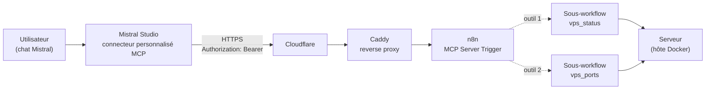

# MCP_N8N — Piloter un serveur en langage naturel via un pont MCP Mistral ↔ n8n

> Comment exposer les outils d'un serveur auto-hébergé à un assistant IA (Mistral) via **n8n** et le protocole **MCP** — en lecture seule, avec authentification Bearer, derrière Cloudflare.

Poser une question en langage naturel dans un chat IA et recevoir **des données réelles du serveur** : uptime, charge CPU, mémoire, disque, ports TCP en écoute… Sans SSH, sans PuTTY.

Ce dépôt documente l'architecture, la mise en œuvre complète, et surtout **les pièges rencontrés** lors du développement réel — chaque erreur ci-dessous a coûté des heures de débogage.

## Architecture



**Principe** : n8n expose un serveur MCP (protocole ouvert de l'industrie) ; Mistral s'y connecte via un connecteur personnalisé ; le modèle choisit et appelle les outils ; chaque outil est un sous-workflow n8n isolé.

## Composants

| Élément | Rôle |
|---|---|
| n8n (auto-hébergé, Docker) | Expose le serveur MCP + exécute les sous-workflows |
| MCP Server Trigger (nœud n8n) | Point d'entrée MCP, auth Bearer |
| Call n8n Workflow Tool (nœuds n8n) | Un nœud = un outil, délégué à un sous-workflow |
| Cloudflare + Caddy | TLS, protection, reverse proxy vers n8n |
| Mistral Studio | Création du connecteur personnalisé (type MCP) |
| Mistral Vibe (chat) | Utilisation finale : conversation + exécution réelle des outils |

## Mise en œuvre

### 1. Côté n8n

1. Créer un workflow avec un nœud **MCP Server Trigger** :
   - **Path** : `vps-tools` → l'endpoint réel sera `/mcp/vps-tools` (voir piège n° 1) ;
   - **Authentication** : **Bearer Auth**, credential contenant **uniquement la valeur du token** (généré par ex. avec `openssl rand -hex 32`).
2. Ajouter un nœud **Call n8n Workflow Tool** par outil, relié au trigger par la connexion pointillée *Tool*. Chaque nœud porte :
   - le **nom de l'outil** (le modèle s'en sert pour choisir) ;
   - une **description claire** de ce que l'outil fait ;
   - un sous-workflow cible qui effectue le travail réel.
3. **Activer** le workflow.

### 2. Côté Mistral Studio (console)

1. **Contexte → Connecteurs → Ajouter un connecteur personnalisé** :
   - Protocole : **MCP** ;
   - Serveur : `https://n8n.votre-domaine.tld/mcp/vps-tools` — le préfixe `/mcp/` est **obligatoire** ;
   - Méthode d'authentification : la méthode correspondant à votre serveur (ici : en-tête personnalisé `Authorization`).
2. Créer la **connexion** avec le token (voir piège n° 3 sur le format exact).
3. Vérifier avec le **Debugger** (bouton *Débugueur* sur la fiche du connecteur) : accès au serveur → authentification → initialisation MCP → outils découverts.

### 3. Côté Mistral Vibe (chat)

1. Nouvelle conversation → menu **+** (ou **/**) → **Connecteurs** → activer le connecteur ;
2. Poser la question : *« Donne-moi l'uptime du serveur »* ;
3. L'agent appelle l'outil `vps_status` et répond avec les données réelles.

⚠️ Le test **doit** se faire dans une conversation : le **Playground** de Studio **simule** les appels d'outils (bloc « simulez la sortie ») et n'exécute jamais le serveur réel.

## Vérifier avec curl

Le MCP *streamable HTTP* exige une poignée de main complète — un `tools/list` direct renvoie `400 Server not initialized`.

```bash
# 1. Initialiser la session (récupérer le mcp-session-id dans la réponse)
curl -s -X POST https://n8n.votre-domaine.tld/mcp/vps-tools \
  -H "Authorization: Bearer <TOKEN>" \
  -H "Content-Type: application/json" \
  -H "Accept: application/json, text/event-stream" \
  -d '{"jsonrpc":"2.0","method":"initialize","params":{"protocolVersion":"2025-03-26","capabilities":{},"clientInfo":{"name":"test","version":"1.0"}},"id":0}'

# 2. Lister les outils avec l'identifiant de session
curl -s -X POST https://n8n.votre-domaine.tld/mcp/vps-tools \
  -H "Authorization: Bearer <TOKEN>" \
  -H "mcp-session-id: <ID_DEPUIS_ETAPE_1>" \
  -H "Content-Type: application/json" \
  -H "Accept: application/json, text/event-stream" \
  -d '{"jsonrpc":"2.0","method":"tools/list","id":1}'
```

Réponse attendue : HTTP 200 + JSON-RPC avec la liste des outils.

## Les 5 pièges rencontrés (retour d'expérience)

### 1. Le préfixe `/mcp/` est automatique

Le MCP Server Trigger de n8n écoute **toujours** sur `/mcp/<path>`, jamais sur `/<path>` seul. Tous les 404 « Cannot POST /vps-tools » venaient de là : ce n'est pas un trigger cassé, c'est le mauvais chemin.

### 2. Le protocole exige une session

Sans `initialize` → `mcp-session-id`, tout appel échoue en 400. Le client MCP (Mistral) gère ça tout seul — mais pas un curl naïf.

### 3. Le token, c'est la valeur seule — partout

- credential n8n : **uniquement** la valeur du token, jamais `TOKEN=...` ni `Bearer ...` ;
- connexion Mistral en mode Bearer : **uniquement** la valeur, le préfixe `Bearer` est ajouté automatiquement ;
- en-tête personnalisé au contraire : la valeur doit contenir `Bearer <token>` complet.

Un token collé avec sa ligne de variable d'environnement entière, ou un double préfixe `Bearer Bearer`, produit des 403/401 silencieux.

### 4. Lire les codes HTTP correctement

- **404** = mauvais chemin ou workflow inactif ;
- **401** = en-tête mal formé (double préfixe typiquement) ;
- **403** = le serveur répond et vérifie l'auth : c'est un **bon signe**, il reste juste un différentiel de token.

Un 403 n'est **pas** un serveur inaccessible.

### 5. Playground ≠ exécution réelle, Debugger ≠ connexion

- Le **Playground** Studio affiche les appels d'outils avec un bloc à simuler manuellement — il n'appelle jamais le serveur ;
- Le **Debugger** teste le serveur mais **ne stocke pas les identifiants** : il faut les ressaisir à chaque session (icône réglages à côté de « Lancer le diagnostic ») ;
- Seule une **conversation** (Vibe) exécute réellement les outils.

## Gouvernance et sécurité

- **Lecture seule d'abord** : les premiers outils ne font que lire (`vps_status`, `vps_ports`) ;
- **Un outil = un sous-workflow** : le workflow MCP exposé reste unique, tout le reste n'est pas public ;
- **Authentification Bearer** sur le trigger n8n : sans token valide, refus explicite ;
- **Aucun secret** dans les noms, descriptions ou schémas d'outils (le modèle les lit) ;
- Actions d'écriture éventuelles : uniquement via `requires_confirmation` (validation humaine avant exécution) ;
- **Un token par client**, rotation facile (regénérer, mettre à jour le credential n8n et la connexion).

## Feuille de route des outils

- ✅ `vps_status` — uptime, charge CPU, mémoire, disque
- ✅ `vps_ports` — ports TCP en écoute + processus
- 🔜 `db_query` — Postgres en lecture stricte (SELECT only, timeout)
- 🔜 `logs_tail` — logs Docker/journalctl bornés en lignes
- 🔜 `backups_status` — état des sauvegardes
- 🔜 `files_read` — lecture de fichiers sur liste blanche
- ⏸️ `service_restart`, `backup_run` — actions encadrées, avec confirmation humaine uniquement

## Contexte technique

Serveur privé (VPS) sous Ubuntu, Docker, Cloudflare, Caddy, n8n auto-hébergé, PostgreSQL. Aucune donnée sensible dans ce dépôt : domaines, tokens, IP et chemins réels sont remplacés par des placeholders.

## Licence

MIT — réutilisez librement, y compris commercialement.